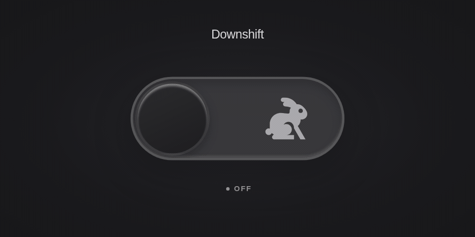
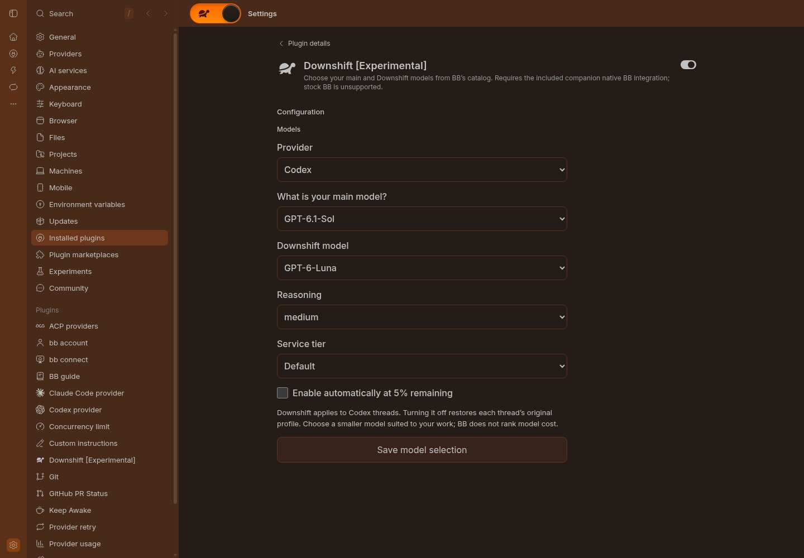
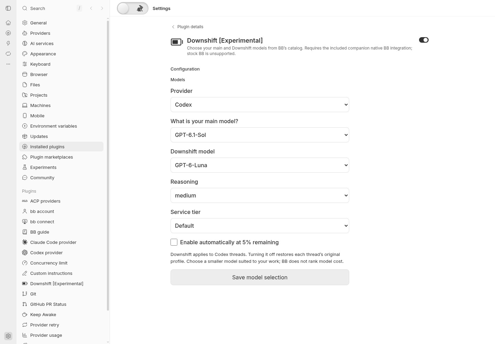

# Downshift

Switch BB threads between model profiles you choose. Downshift supports the
models and providers available in BB with a confirmed native catalog. Choose
both your main and Downshift profiles within the same provider.

**Experimental: requires a companion BB source build. Stock BB is unsupported.**
The package includes an implemented, reviewable native integration for the exact
BB source revision in [NATIVE-INTEGRATION.md](compatibility/NATIVE-INTEGRATION.md).
This capability has not shipped upstream. Installing the UI alone does not
change execution; stock BB keeps the switch disabled.

## Screenshots

**Downshift on:** the turtle switch and orange theme make the active mode visible.



**Model setup:** choose your main and Downshift models, reasoning and service tier.



## Choose your models

Open **Settings → Plugins → Downshift → Models**, or open the switch’s details.
Choose your provider, answer **“What is your main model?”**, then choose a smaller
Downshift model. All choices come from BB’s current catalog on the primary machine.
There is no preselected provider or hard-coded main model. The same model can
also be selected with a different reasoning level or service tier. Any available BB
provider can be selected when it supplies a confirmed model catalog. Models
whose reasoning discovery is still unknown are not selectable.

The Downshift model stays with the same provider to preserve existing sessions.
You choose its reasoning and service tier; the tier starts at Default. BB does
not rank model cost, so choose a model appropriate for your subscription and work.
A provider whose catalog requires a workspace must first expose those models
through BB’s primary-machine catalog; otherwise setup reports that no confirmed
models are available. Target hosts still validate the profile independently.

The main model identifies your usual workload and quota context. Turning Downshift
OFF restores **each thread’s original profile**, including inherited model,
reasoning, Fast, permission and source values. It does not replace every thread
with the main model. Other providers keep their execution. Active calls finish
naturally; the next native boundary uses the selected profile. Change model
selection only after OFF restoration completes.

## Automatic activation

Automatic activation is optional for any selected provider that exposes quota
through BB. After saving your model selection, enable its checkbox to request
Downshift when **any applicable window has 5% or less remaining**. The observer
uses the primary machine's native `provider.usage` source through BB's SDK.
It considers exact main-model limits, Claude's explicit native model-family
metadata, and real shared-provider windows. A low limit for another model alone
does not trigger your main model. Accounts and machines are not added together.

There is no automatic OFF. With a reset date, manual OFF holds until that
window resets. Without a reset date, it holds until a fresh reading confirms
recovery above 5%; a later low episode can activate again. Indistinguishable
undated windows retain their separate readings but share a conservative decision
group: any-low triggers, and manual OFF requires all original group members to
recover. A missing member, unknown/error response or label/order change cannot
remove this barrier. OFF during unknown quota durably binds the first confirmed
windows. Existing v1 automatic records migrate conservatively; native identity
and restoration journals stay unchanged.

If the provider supplies an issuer account key, decisions are account-scoped.
Otherwise decisions are explicitly **connection-scoped** to the selected provider
and primary machine. An uncertain connection-scoped request is never replayed;
a new fresh decision gets a new UUID and CAS check. Every automatic activation
requires another fresh quota reading after its durable preparation. Connection
scope cannot prove an unreported account change, so manual suppression stays
conservative across account metadata changes. No email, token or invented account
identity is used. [Quota sources and guarantees](compatibility/QUOTA-SOURCES.md)
explain this distinction.

Unknown, expired, unlimited-only, malformed or stale data never activate the
mode. A provider with no usage capability needs a native provider quota source;
context tokens, guessed budgets and spending without a known limit are not
substitutes. The observer checks every 30 seconds, without starting a model or
calling a separate account API. Shared subscription exhaustion is still a hard
limit. Model/provider changes, disposal and in-flight manual OFF cancel old
activation work. No real subscribed model call is claimed by the fixture tests.

## Control

The icon switch slides between original profiles (rabbit) and Downshift (turtle).
Click, tap or swipe it; Space, Enter and arrow keys work from the keyboard.
OFF follows the selected BB theme; ON has an orange track. The removable warm
tint follows that same theme. Cached last-confirmed ON stays visibly unconfirmed
until the server responds. Warnings expose details when needed. All text is English.

There is no quota percentage widget. Quota is read internally for automatic
activation; an independent quota display can be installed separately.

## Native installation and compatibility

Follow [the companion build guide](compatibility/NATIVE-INTEGRATION.md). The
source helper checks an exact clean upstream checkout and the patch checksum.
It is read-only unless `--apply` is supplied. It never patches an installed
runtime, restarts a service or changes auto-update settings. Server and execution
hosts must use the compatible native build, including host protocol 273.

Manifest engine ranges express SDK/build compatibility only. They do not imply
the capability exists in stock BB. Runtime detection requires `bb.execution-policy/v1`
and every specified execution, catalog-validation and restoration semantic.
It also requires `consistent-durable-registry`; companion builds without the
registry/journal recovery check are refused, even if their protocol matches.
There is no polling-based execution rewrite or mass thread-option mutation.

## Build and inspect

```sh
npm ci --ignore-scripts
npm rebuild better-sqlite3
npm run check
npm test
bb plugin build .
npm pack --dry-run --ignore-scripts
npm pack --ignore-scripts
```

Development tests use the SDK’s real SQLite storage harness; native Node build
tools are needed if a compatible SQLite binary is unavailable. BB builds source
for Git installs. An npm archive includes prebuilt `dist` artifacts. The SDK and
React are provided by BB; Zod is the runtime dependency. Plugins run as full-trust
server code in BB.

## Install and remove

Moving from the former Economy plugin? Follow the explicit
[OFF → uninstall → install procedure](compatibility/UPGRADING-FROM-ECONOMY.md).
The plugin ID changes to `downshift`; existing journals and settings are not
automatically migrated. Legacy v1 RPC method names remain stable.

After choosing the companion server explicitly:

```sh
bb plugin install . --yes
bb plugin rpc call downshift economy_configuration --json
bb plugin rpc call downshift economy_state --json
bb plugin disable downshift
bb plugin uninstall downshift
```

Configure models through the UI, then require `available:true`, no state error,
and the profile you selected. Installing alone does not enable Downshift; save your model selection first.
Removing the plugin removes its UI and palette attribute. Native provenance and
restore readers remain in core. Never delete their journals or replace core with
an older binary as an uninstall shortcut.

## Privacy and license

The package ships no account data, thread history, database, configuration or
credentials. Quota normalization discards account email, plan and unrelated
fields; durable source/window identities are hashes, never raw account keys. Marketplace captures use a separate empty BB instance. Native transport
and scripted bridge tests are identified separately from real subscribed model
calls; no real model continuation is claimed without that evidence.

MIT. Navigation uses Phosphor Fill 2.1.1. The user-selected rabbit and turtle
control silhouettes use Material Design Icons under Apache-2.0. Artwork,
provenance and licenses are in `assets/`. The upstream BB license accompanies
the source patch under `compatibility/`.
